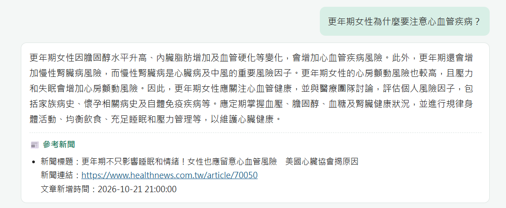
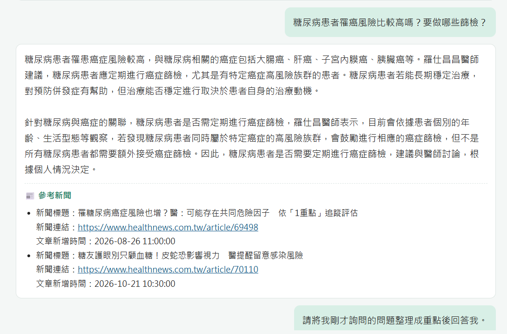
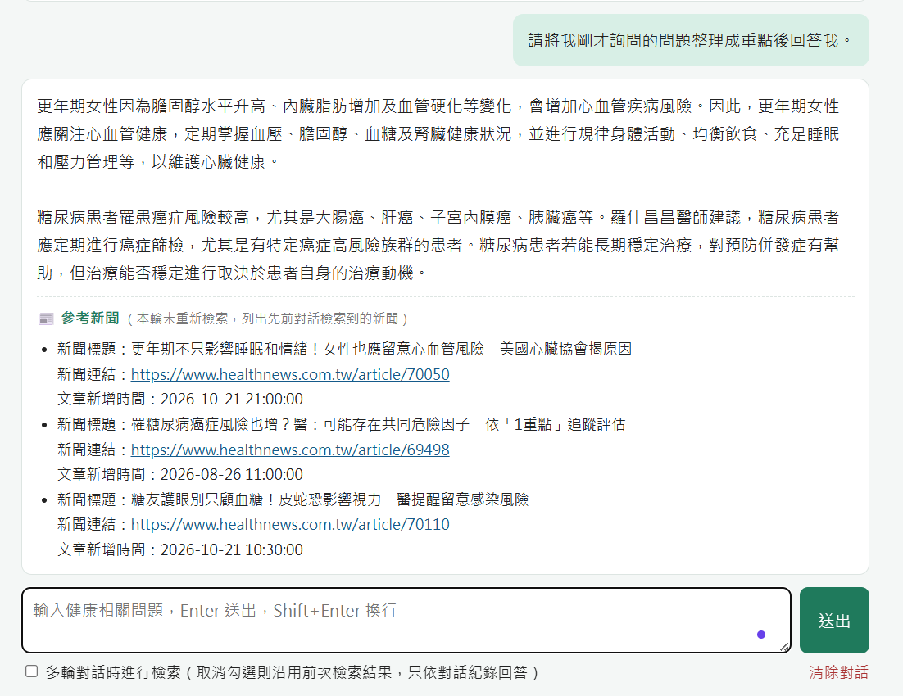

# 🩺 健康諮詢小幫手（RAG × 健康醫療網）

以 **檢索增強生成（Retrieval-Augmented Generation, RAG）** 建立的健康諮詢問答系統。
系統爬取 [健康醫療網](https://www.healthnews.com.tw/) 「新聞分類」底下的新聞，用 **地端模型（Ollama）** 產生摘要與向量索引，再透過網頁介面與使用者進行多輪問答，並在每次回答後附上檢索到的新聞來源。

### 資料現況

| 項目 | 數量 |
|---|---|
| 爬取新聞（9 個分類 × 2 頁） | 175 篇 |
| 已產生摘要並建立向量索引 | 27 篇（皆為「醫療疾病」分類，資料發布時間 2026-03 ～ 2026-10） |
| 測試集 | 22 題 |

> 為節省時間，本次只對 27 篇新聞產生摘要（CPU 上每篇約 1 分鐘）。`data/news.db` 與 `index/` 已一併上傳，下載後可直接啟動網頁；要補完其餘文章，執行 `python summarize.py` 後再 `python build_index.py`。

---

## 功能總覽

| 需求 | 實作方式 | 檔案 |
|---|---|---|
| 網路爬蟲取得「新聞分類」資料 | `requests` + `BeautifulSoup` 爬取 9 個新聞頻道（醫療疾病、生醫新知、健康保健、醫學美容、中醫養生、運動復健、營養飲食、樂齡照顧、心靈樂活） | `crawler.py` |
| 資料庫資料表 | SQLite `data/news.db`，資料表 `news` | `db.py` |
| 文章摘要 | 將「新聞標題 + 文章全文」字串合併，交給地端模型 `qwen2.5:3b` 產生摘要 | `summarize.py` |
| 向量索引 | 用地端向量模型 `bge-m3` 將「文章摘要」轉成向量，存成 `index/vectors.npy` + `index/ids.json` | `build_index.py` |
| 問答系統 | 向量檢索（餘弦相似度 Top-K）＋ 地端模型生成回答 | `rag.py` |
| 網頁介面 | Flask 網頁，含「多輪對話時進行檢索」checkbox | `app.py`、`templates/index.html` |
| 回答附上來源 | 每次回答後以條列列出 **新聞標題、新聞連結、文章新增時間** | `rag.py`、`index.html` |

## 系統架構

```
健康醫療網 ──爬蟲──▶ SQLite (news) ──標題+全文──▶ 地端 LLM ──▶ 文章摘要
                                                               │
                                                               ▼
                                                  地端 Embedding (bge-m3)
                                                               │
                                                               ▼
                                                  向量索引 vectors.npy
                                                               │
使用者問題 ──Embedding──▶ 相似度檢索 Top-K ──▶ 組合提示詞 ──▶ 地端 LLM ──▶ 回答 + 參考新聞清單
```

## 資料表結構（`news`）

| 欄位 | 型態 | 說明 |
|---|---|---|
| `id` | INTEGER PK AUTOINCREMENT | 流水號 |
| `title` | TEXT | 新聞標題 |
| `url` | TEXT UNIQUE | 新聞連結 |
| `category` | TEXT | 新聞分類（頻道名稱） |
| `author` | TEXT | 記者／來源 |
| `content` | TEXT | 文章全文 |
| `summary` | TEXT | 文章摘要（地端模型產生） |
| `published_at` | TEXT | 文章新增時間（網站發布時間） |
| `crawled_at` | TEXT | 寫入資料庫的時間 |

## 專案結構

```
NLP3/
├── config.py          # 設定：模型名稱、資料庫路徑、爬蟲頻道
├── db.py              # SQLite 資料表與存取
├── llm.py             # 呼叫 Ollama（chat / embed）
├── crawler.py         # 步驟 1：爬蟲
├── summarize.py       # 步驟 2：產生文章摘要
├── build_index.py     # 步驟 3：建立向量索引
├── rag.py             # 檢索 + 生成核心邏輯
├── testset.json       # 測試集（22 題）
├── evaluate.py        # 檢索評估
├── app.py             # 步驟 4：網頁問答系統
├── templates/
│   └── index.html     # 前端聊天介面
├── data/news.db       # 爬下來的新聞資料庫
├── index/             # 向量索引
├── requirements.txt
└── README.md
```

---

## 安裝與執行

### 0. 環境需求
- Windows / macOS / Linux
- Python 3.10 以上
- [Ollama](https://ollama.com/download)（執行地端模型）
- 建議 16GB 記憶體以上；有 GPU 會快很多

本專案的測試環境：Windows 11、Python 3.14、Ollama 0.40.8、`qwen2.5:3b` + `bge-m3`。

### 取得程式碼
```bash
git clone https://github.com/HSUN0724/NLP.git
cd NLP/NLP3
```

### 1. 安裝 Ollama 並下載模型
安裝 Ollama 後，在終端機執行：
```bash
ollama pull qwen2.5:3b   # 對話／摘要模型（預設，速度快）
ollama pull bge-m3       # 向量模型（支援多語言）
```
> 電腦效能較好可改用 `qwen2.5:7b`（回答品質較佳）：先 `ollama pull qwen2.5:7b`，再設定環境變數 `CHAT_MODEL=qwen2.5:7b`（見下方「更換模型」）。

### 2. 建立 Python 虛擬環境並安裝套件
```powershell
python -m venv .venv
.\.venv\Scripts\activate          # macOS/Linux: source .venv/bin/activate
pip install -r requirements.txt
```

> 資料庫與向量索引已附在專案中，想直接體驗可跳過步驟 3～5，直接執行步驟 6。

### 3. 爬取新聞
```bash
python crawler.py --pages 2       # 每個分類抓 2 頁（約 170 篇）
```

### 4. 產生文章摘要
```bash
python summarize.py               # 只處理還沒有摘要的文章，中斷後可重跑
python summarize.py --limit 10    # 先試 10 篇
```

### 5. 建立向量索引
```bash
python build_index.py
```

### 6. 啟動網頁問答系統
```bash
python app.py
```
打開瀏覽器進入 <http://127.0.0.1:5000>

---

## 使用說明

- **第一輪提問一定會進行檢索**。
- 勾選 **「多輪對話時進行檢索」**：之後每一輪都會用新問題重新檢索新聞。
- 取消勾選：之後的問題不再檢索，模型只依對話紀錄回答，並列出先前各輪檢索到的參考新聞（介面上會標示「本輪未重新檢索」）。
- 每次回答後面都會條列附上：**新聞標題、新聞連結、文章新增時間**。
- 「清除對話」會清空對話紀錄，重新開始。

### 示範流程

1. 【勾選檢索】問題一：`更年期女性為什麼要注意心血管疾病？`
2. 【勾選檢索】問題二：`糖尿病患者罹癌風險比較高嗎？要做哪些篩檢？`
3. 【取消勾選】問題三：`請將我剛才詢問的問題整理成重點後回答我。`

第三題不重新檢索，模型會依對話紀錄整理前兩題的重點，並列出前兩輪檢索到的所有新聞。

### 實際執行結果

**問題一**（檢索）：更年期女性為什麼要注意心血管疾病？

> 更年期期間女性雌激素下降，會出現膽固醇升高、內臟脂肪增加、血管硬化等變化，增加心血管疾病風險；心房顫動與慢性腎臟病風險也會上升……建議及早與醫療團隊討論，評估個人風險，並規律運動、均衡飲食、充足睡眠與壓力管理。
>
> 📰 參考新聞
> - 新聞標題：更年期不只影響睡眠和情緒！女性也應留意心血管風險　美國心臟協會揭原因<br>新聞連結：https://www.healthnews.com.tw/article/70050<br>文章新增時間：2026-10-21 21:00:00

**問題二**（檢索）：糖尿病患者罹癌風險比較高嗎？要做哪些篩檢？

> 糖尿病患者罹患大腸癌、肝癌、子宮內膜癌、胰臟癌等風險較高，但尚未證實糖尿病會直接導致癌症，兩者可能有肥胖、抽菸、飲酒等共同危險因子……醫師會依年齡、生活型態判斷，屬於特定癌症高風險族群者才建議進行相應篩檢。
>
> 📰 參考新聞
> - 新聞標題：罹糖尿病癌症風險也增？醫：可能存在共同危險因子　依「1重點」追蹤評估<br>新聞連結：https://www.healthnews.com.tw/article/69498<br>文章新增時間：2026-08-26 11:00:00
> - 新聞標題：糖友護眼別只顧血糖！皮蛇恐影響視力　醫提醒留意感染風險<br>新聞連結：https://www.healthnews.com.tw/article/70110<br>文章新增時間：2026-10-21 10:30:00

**問題三**（不檢索）：請將我剛才詢問的問題整理成重點後回答我。

> **更年期女性需要注意的心血管疾病重點**
> 1. 膽固醇可能升高，增加心血管疾病風險。
> 2. 內臟脂肪增加會導致血管硬化。
> 3. 心房顫動風險較高，壓力和失眠會使風險增加。
> 4. 慢性腎臟病風險較高，而慢性腎臟病是心臟病及中風的重要風險因子。
>
> **糖尿病患者需要注意的癌症風險重點**
> 1. 罹患大腸癌、肝癌、子宮內膜癌、胰臟癌等風險較高。
> 2. 屬於特定癌症高風險族群者應定期篩檢。
> 3. 也應留意皮蛇的風險，並及時就醫治療。
>
> 📰 參考新聞（本輪未重新檢索，列出先前對話檢索到的新聞）
> - 新聞標題：更年期不只影響睡眠和情緒！女性也應留意心血管風險　美國心臟協會揭原因<br>新聞連結：https://www.healthnews.com.tw/article/70050<br>文章新增時間：2026-10-21 21:00:00
> - 新聞標題：罹糖尿病癌症風險也增？醫：可能存在共同危險因子　依「1重點」追蹤評估<br>新聞連結：https://www.healthnews.com.tw/article/69498<br>文章新增時間：2026-08-26 11:00:00
> - 新聞標題：糖友護眼別只顧血糖！皮蛇恐影響視力　醫提醒留意感染風險<br>新聞連結：https://www.healthnews.com.tw/article/70110<br>文章新增時間：2026-10-21 10:30:00

（問題一、二的回答內容為節錄；問題三為完整回答。）

<!-- 執行後可把截圖放在 docs/ 資料夾並在此引用，例如：



-->

---

## 測試集與檢索評估

`testset.json` 收錄 22 題測試問題，每題對應一篇已產生摘要的新聞（`expected_id`）。問題以一般民眾的口吻改寫，不直接照抄新聞標題。

```bash
python evaluate.py              # 評估檢索：Hit@1、Hit@3、MRR
python evaluate.py --answer 2   # 另外讓模型實際回答前 2 題
```

目前結果（27 篇摘要、`bge-m3`）：

| 題數 | Hit@1 | Hit@3 | MRR |
|---|---|---|---|
| 22 | 100.0% | 100.0% | 1.000 |

測試題目一覽：

| # | 測試問題 | 對應新聞 id |
|---|---|---|
| 1 | 攝護腺癌的焦點治療適合哪些病人？要做哪些評估？ | 1 |
| 2 | 秋冬聚餐多容易變胖，要怎麼管理體重和局部脂肪？ | 2 |
| 3 | XLH 是什麼疾病？成年病友面臨哪些困難？ | 4 |
| 4 | 主動脈瓣膜狹窄的治療為什麼要考慮終身管理？ | 5 |
| 5 | 婦科手術後要怎麼預防沾黏？ | 6 |
| 6 | HER2 陽性轉移性乳癌的雙標靶治療有什麼好處？ | 7 |
| 7 | 更年期女性為什麼要注意心血管疾病？ | 9 |
| 8 | 中風病人除了取栓，中醫針灸對復健有幫助嗎？ | 10 |
| 9 | 驗孕陽性但超音波看不到胚胎，可能是什麼情況？ | 11 |
| 10 | 吃飯吃太快會影響減重嗎？怎樣才能吃慢一點？ | 12 |
| 11 | 糖尿病患者得了帶狀疱疹會影響眼睛嗎？ | 13 |
| 12 | 老人家跌倒後幾週才頭痛、走路不穩，要注意什麼？ | 14 |
| 13 | 父母過度保護會對孩子的情緒造成什麼影響？ | 15 |
| 14 | 孩子發燒可以先問 AI 嗎？兒科醫師怎麼建議？ | 16 |
| 15 | 用 AI 查藥物資訊之後可以自己停藥嗎？ | 17 |
| 16 | 腹膜透析和血液透析怎麼選，才能兼顧生活品質？ | 20 |
| 17 | 血鉀太高有什麼危險？心衰竭病人為什麼容易高血鉀？ | 21 |
| 18 | 慢性腎臟病要少吃蛋白質，但又怕肌少症，該怎麼吃？ | 23 |
| 19 | 糖尿病患者罹癌風險比較高嗎？要做哪些篩檢？ | 24 |
| 20 | 吃 allopurinol 降尿酸前，為什麼要做基因檢測？ | 25 |
| 21 | 眼睛曬傷有什麼症狀？夏天要怎麼護眼？ | 26 |
| 22 | 懷孕時打類固醇會增加小孩感染的風險嗎？ | 27 |

## 測試中發現並修正的問題

| 問題 | 原因 | 修正 |
|---|---|---|
| 「整理重點」只整理到最後一題 | 小模型容易忽略較早的對話 | 不檢索時，把先前所有問題列在提示詞中 |
| 列出不相關的參考新聞 | Top-K 固定取 3 篇 | 加入相似度門檻 `MIN_SCORE = 0.58` |
| 回答混入簡體字 | `qwen2.5` 偶爾切換成簡體 | 系統提示詞要求只用繁體中文 |
| 回答引用無關新聞的內容 | 模型把所有參考資料都套進回答 | 系統提示詞要求忽略無關內容 |

---

## 更換模型

可用環境變數覆寫 `config.py` 的設定：

```powershell
# PowerShell
$env:CHAT_MODEL="qwen2.5:7b"; $env:EMBED_MODEL="bge-m3"; $env:TOP_K="5"
python app.py
```
```bash
# macOS / Linux
CHAT_MODEL=qwen2.5:7b TOP_K=5 python app.py
```

> ⚠️ 更換 `EMBED_MODEL` 後必須重新執行 `python build_index.py`。

## 實作細節

- **爬蟲**：新聞頻道列表頁網址為 `/channel/<頻道ID>/`，第 N 頁為 `/channel/<頻道ID>/N`。文章頁從 `#article-title h1` 取標題、`#article-content` 取全文、`meta[property="article:published_time"]` 取發布時間（沒有時改用頁面上的日期）。每次請求間隔 0.5 秒，以 URL 去除重複。
- **摘要**：標題與全文合併後截取前 4000 字，請模型輸出 150～250 字的繁體中文摘要。
- **向量索引**：向量經 L2 正規化後存成 NumPy 矩陣，查詢時以內積計算餘弦相似度，取 Top-K（預設 3）篇；相似度低於 `MIN_SCORE`（預設 0.58）的新聞不採用，但第 1 名一定保留。這個門檻是依測試集觀察訂的：正確新聞的相似度約 0.60～0.81，無關新聞多在 0.40～0.57。
- **多輪對話**：取消勾選檢索時，系統會把先前問過的問題列給模型，並附上先前各輪檢索過的所有新聞（依連結去重）。
- **生成**：將檢索到的新聞標題、摘要與內文節錄放入提示詞，連同對話紀錄送給地端模型。參考新聞清單由程式附加，不靠模型產生，確保來源正確。

## 注意事項

- 本系統回答僅供參考，不能取代專業醫療診斷。
- 新聞內容版權屬健康醫療網所有，本專案僅作課堂學習用途。
